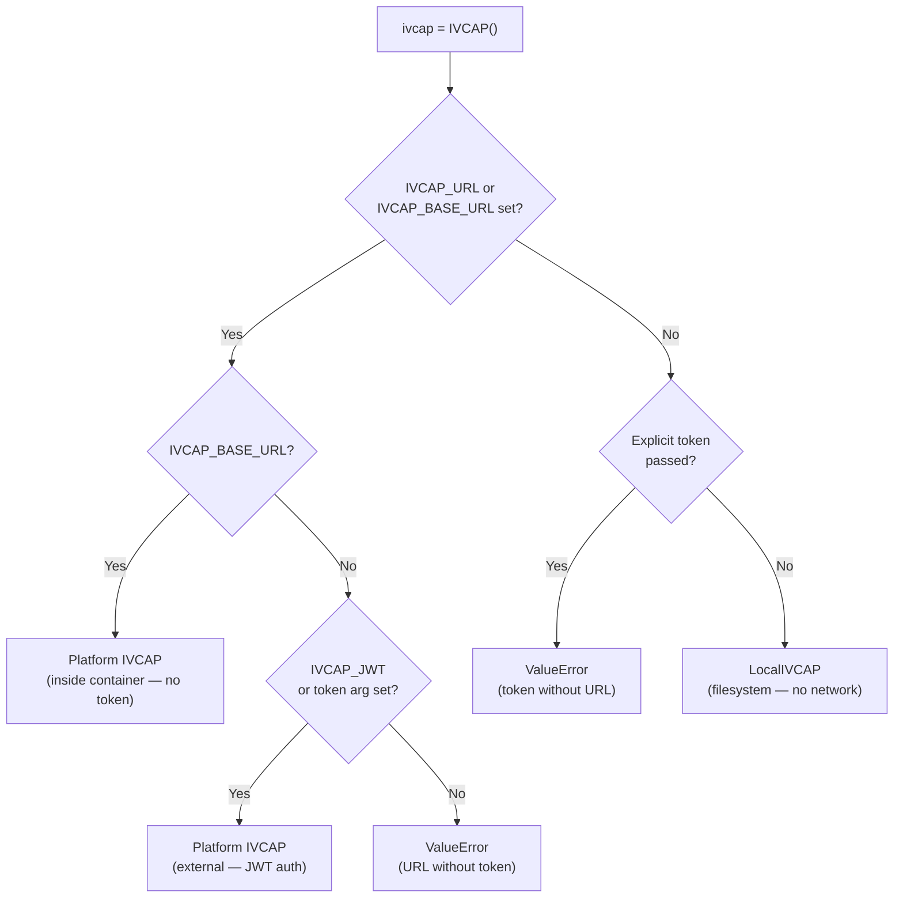

# Local Mode — Testing Services Without a Platform

This guide explains how to choose the right `IVCAP` instance for your situation and,
in particular, how to test an IVCAP service locally against real data before deploying
it to the platform.

## Table of Contents

- [The Three Operating Modes](#the-three-operating-modes)
- [Mode 1 — Platform (External Access)](#mode-1-platform-external-access)
- [Mode 2 — Platform (Inside a Container)](#mode-2-platform-inside-a-container)
- [Mode 3 — Local Mode (No Platform Required)](#mode-3-local-mode-no-platform-required)
  - [Local directory layout](#local-directory-layout)
  - [Configuring the base directory](#configuring-the-base-directory)
  - [Forcing local mode in tests](#forcing-local-mode-in-tests)
  - [What `LocalIVCAP` supports](#what-localivcap-supports)
  - [Resolving real platform artifact URNs locally](#resolving-real-platform-artifact-urns-locally)
  - [Detecting the active mode at runtime](#detecting-the-active-mode-at-runtime)
- [Writing Code That Works in All Three Modes](#writing-code-that-works-in-all-three-modes)
- [See Also](#see-also)

---

## The Three Operating Modes

`ivcap_client` supports three distinct operating modes. The correct one is selected
**automatically** from environment variables, so the same `ivcap = IVCAP()` line works
everywhere.



| Mode | Typical use case | ENV vars needed |
|---|---|---|
| **Platform (external)** | Apps, scripts, notebooks accessing a live deployment | `IVCAP_URL` + `IVCAP_JWT` |
| **Platform (in-container)** | Code running inside an IVCAP job container | `IVCAP_BASE_URL` (injected by platform) |
| **Local** | Local development and service pre-deployment testing | None |

---

## Mode 1 — Platform (External Access)

**Typical users:** data engineers, researchers, and AI agents writing scripts that
orchestrate work on an IVCAP deployment — submitting jobs, uploading data, querying
results, and annotating artifacts.

```python
from dotenv import load_dotenv
from ivcap_client import IVCAP

# Load IVCAP_URL and IVCAP_JWT from a .dbg-env or .env file
load_dotenv(".dbg-env")

ivcap = IVCAP()  # → full platform IVCAP instance

# Discover services
for svc in ivcap.list_services(limit=10):
    print(svc)

# Upload data, run a job, retrieve results
import io, json, time
artifact = ivcap.upload_artifact(name="input.csv", file_path="/data/input.csv")
svc = ivcap.get_service_by_name("my-analysis")
job = svc.request_job(io.StringIO(json.dumps({"input": artifact.id})))
while not job.finished:
    time.sleep(5)
    job.refresh()
print(job.result)
```

**Credentials:** Set these in your environment or a `.env` file:

```
IVCAP_URL=https://api.your-ivcap-deployment.net
IVCAP_JWT=<token from: ivcap context get access-token>
```

See the [Authentication guide](../getting-started/authentication.md) for details.

---

## Mode 2 — Platform (Inside a Container)

**Typical users:** service code running inside an IVCAP job container — i.e. code you
have packaged with the [ivcap-service-sdk](https://pypi.org/project/ivcap_service/) and
deployed to the platform.

When a service container starts, the IVCAP platform automatically injects:

```
IVCAP_BASE_URL=http://ivcap.local   # the Service Sidecar URL
```

No JWT token is needed — `IVCAP()` would pick this up automatically. **However, inside
an actual `ivcap-service-sdk` worker function you should never call `IVCAP()`
yourself.** The SDK's
[`JobContext`](https://ivcap-works.github.io/ivcap-service-sdk-python/api/job-context/#ivcap-ivcap)
— passed as the second argument to every `process_job(req, ctxt)` worker — already
exposes a lazy-initialized, pre-authenticated client via its `ctxt.ivcap` **property**
(no parentheses — it's a property, not a method). Use that handle instead:

```python
from ivcap_service import JobContext

def process_job(req: MyRequest, ctxt: JobContext) -> MyResult:
    ivcap = ctxt.ivcap  # property access — pre-authenticated, sidecar-backed

    # Reads and writes go through the sidecar, which handles auth and storage
    artifact = ivcap.get_artifact(req.input_urn)
    with artifact.as_local_file() as path:
        data = path.read_bytes()

    result_artifact = ivcap.upload_artifact(name="result.nc", file_path="/tmp/result.nc")
    ivcap.add_aspect(
        entity=result_artifact.id,
        aspect={"$schema": "urn:my:schema:result.1", "quality": 0.95},
    )
    return MyResult(output=result_artifact.id)
```

`ctxt.ivcap` returns the same kind of platform `IVCAP` instance you'd get from calling
`IVCAP()` directly — so everything else in this guide (artifact/aspect APIs, etc.)
applies unchanged. The only difference is *who* constructs it: letting `JobContext` do
it avoids re-deriving `IVCAP_BASE_URL`/auth wiring yourself and keeps your worker
function testable (you can inject a `LocalIVCAP` via a fake `JobContext` in unit tests
— see Mode 3 below).

This mode is fully transparent to the rest of this guide — the same artifact/aspect
code works in Mode 1 and Mode 2 without any conditional logic; only how you *obtain*
the `IVCAP` instance differs (`IVCAP()` directly outside a service vs. `ctxt.ivcap`
inside one).

---

## Mode 3 — Local Mode (No Platform Required)

**Typical users:** service developers who want to run and test their service logic
locally against real input files, *before* deploying to a platform.

When neither `IVCAP_URL` nor `IVCAP_BASE_URL` is set, `IVCAP()` automatically returns
a **`LocalIVCAP`** instance — a filesystem-backed subclass of `IVCAP` that stores
artifacts and aspects under a local directory. No network calls are made.

```python
from ivcap_client import IVCAP

ivcap = IVCAP()  # → LocalIVCAP (no URL env vars set)

# Works exactly like the platform version
artifact = ivcap.upload_artifact(name="result.csv", file_path="/tmp/result.csv")
print(artifact.id)
# urn:file:///abs/path/to/ivcap-artifacts/artifacts/result.csv

aspect = ivcap.add_aspect(
    entity=artifact.id,
    aspect={"$schema": "urn:my:schema:tag.1", "label": "test"},
)
print(aspect.id)
# urn:ivcap:aspect:<uuid>
```

### Local directory layout

All data is stored under `base_dir` (default: `ivcap-artifacts` in the current
working directory):

```
ivcap-artifacts/
  artifacts/          ← files written by upload_artifact()
    result.csv
    deep/nested/file.nc
  aspects/            ← JSON files written by add_aspect() / update_aspect()
    <uuid>.json
    <uuid>.json
```

### Configuring the base directory

In order of priority (highest first):

1. **Explicit argument** to `LocalIVCAP()` or `IVCAP.local()`:
   ```python
   ivcap = IVCAP.local(base_dir="./my-test-output")
   ```
2. **`IVCAP_LOCAL_DIR` environment variable:**
   ```bash
   export IVCAP_LOCAL_DIR=./test-output
   python my_service.py
   ```
3. **Default:** `ivcap-artifacts` (relative to the current working directory)

### Forcing local mode in tests

Use `IVCAP.local()` or construct `LocalIVCAP` directly to guarantee local mode
regardless of which environment variables happen to be set — useful in unit tests:

```python
import pytest
from ivcap_client import IVCAP, LocalIVCAP

@pytest.fixture
def ivcap(tmp_path):
    """Always returns a LocalIVCAP backed by a fresh temp directory."""
    return IVCAP.local(base_dir=tmp_path / "artifacts")

def test_my_service(ivcap, tmp_path):
    # Prepare a test input file
    src = tmp_path / "input.csv"
    src.write_text("a,b\n1,2\n")

    # Run service logic that calls ivcap.upload_artifact / ivcap.add_aspect
    artifact = ivcap.upload_artifact(name="input.csv", file_path=str(src))
    assert artifact.id.startswith("urn:file://")

    # Confirm the file landed in the right place
    from pathlib import Path
    dest = Path(artifact.id[len("urn:file://"):])
    assert dest.exists()
```

### What `LocalIVCAP` supports

`LocalIVCAP` is a **subclass of `IVCAP`** and covers the operations needed to run and
test service logic locally:

**Artifacts**

| Method | Local behaviour |
|---|---|
| `upload_artifact(name, file_path, ...)` | Copies source file to `base_dir/artifacts/<name>` |
| `upload_artifact(name, io_stream, ...)` | Writes stream bytes/text to `base_dir/artifacts/<name>` |
| `get_artifact("urn:file://..." or "file://...")` | Returns a `LocalFileArtifact` for an existing local file |
| `get_artifact("urn:ivcap:artifact:<uuid>")` | Resolves to a local file via `register_artifact()` or a `.ivcap-<filename>.txt` sidecar — see below |
| `register_artifact(urn, file_path, *, mime_type=None)` | In-memory mapping from a real platform artifact URN to a local file |
| `collection`, `policy`, `chunk_size`, `retries` args | Accepted for API compatibility; silently ignored |

### Resolving real platform artifact URNs locally

Service code often receives artifact references as platform URNs
(`urn:ivcap:artifact:<uuid>`), not as local file paths — the same code should run
unmodified whether it's being debugged locally or executing on the platform. By
default `LocalIVCAP.get_artifact()` raises `ResourceNotFound` for such a URN, since it
has no network access to resolve it. Two mechanisms let you bridge this gap, both of
which rely on the same `.ivcap-<filename>.txt` sidecar format used for upload
deduplication (`<md5>|<artifact-urn>[|<mime-type>]`):

1. **`register_artifact()`** — an explicit, in-memory-only mapping for the current
   process. Nothing is written to disk.

   ```python
   ivcap = IVCAP.local()

   # Run the service on the platform once, note the artifact URN it
   # produced/consumed, download a local copy of its content, then:
   ivcap.register_artifact(
       "urn:ivcap:artifact:1234...-uuid",
       "/tmp/fixtures/input.csv",
       mime_type="text/csv",   # optional — overrides extension guessing
   )

   artifact = ivcap.get_artifact("urn:ivcap:artifact:1234...-uuid")
   # → LocalFileArtifact wrapping /tmp/fixtures/input.csv, no network call
   ```

2. **Automatic sidecar scan** — if a file under `base_dir` was previously uploaded
   via the *platform* `IVCAP.upload_artifact()` (which writes a
   `.ivcap-<filename>.txt` sidecar recording its real artifact URN and md5), a
   `LocalIVCAP` instance will find it automatically — no `register_artifact()` call
   needed:

   ```python
   artifact = ivcap.get_artifact("urn:ivcap:artifact:1234...-uuid")
   # → scans base_dir for a matching .ivcap-*.txt sidecar and resolves it
   ```

   The content's md5 is re-verified on every lookup; if the local file was edited
   since the sidecar was written, the match is rejected and `ResourceNotFound` is
   raised rather than silently serving stale content.

Both paths also restore the artifact's real `mime_type` when it was recorded (via
`register_artifact(..., mime_type=...)` or `mark_file_already_uploaded(..., mime_type=...)`),
instead of falling back to guessing it from the local filename's extension — useful
for extension-less or renamed fixture files.

**Aspects** (stored as JSON files under `base_dir/aspects/`)

| Method | Local behaviour |
|---|---|
| `add_aspect(entity, aspect, *, schema)` | Writes `<uuid>.json`; returns a `LocalAspect` |
| `update_aspect(entity, aspect, *, schema)` | Same as `add_aspect` (no retraction in local mode) |
| `get_aspect(aspect_id)` | Reads the JSON file by full URN or bare UUID |
| `list_aspects(entity, schema, limit)` | Scans `aspects/` directory; supports `entity`, `schema`, and `limit` filters |

> **Note:** Methods that require a live platform connection (`list_services`,
> `list_orders`, `list_artifacts`, `search`, etc.) are not overridden and will raise
> `AttributeError` if called on a `LocalIVCAP` instance, since the underlying
> `_client` attribute is not set.

### Detecting the active mode at runtime

```python
from ivcap_client import IVCAP, LocalIVCAP

ivcap = IVCAP()

if isinstance(ivcap, LocalIVCAP):
    print(f"Local mode — artifacts under: {ivcap.base_dir}")
else:
    print(f"Platform mode — connected to: {ivcap.url}")
```

---

## Writing Code That Works in All Three Modes

The central design goal is that **your core logic needs zero conditional logic** around
how it obtains an `IVCAP` handle. The pattern differs slightly depending on *what* is
calling it:

- **Standalone scripts / notebooks / CLI tools / library code** (i.e. anything *not*
  packaged as an `ivcap-service-sdk` worker function) — call `IVCAP()` directly, as
  shown below. The right implementation (`LocalIVCAP` vs. platform `IVCAP`) is injected
  automatically from environment variables.
- **`ivcap-service-sdk` worker functions** (`def process_job(req, ctxt: JobContext)`)
  — as covered in [Mode 2](#mode-2--platform-inside-a-container), use `ctxt.ivcap`
  instead of calling `IVCAP()` yourself; the SDK already constructs and injects a
  correctly configured handle (platform-connected when deployed, and whatever you
  configure your test `JobContext` fixture to return — typically a `LocalIVCAP` — when
  unit testing locally).

```python
# my_script.py — a standalone script/tool, NOT an ivcap-service-sdk worker function.
# Works locally AND against a live platform unchanged.
from ivcap_client import IVCAP

def run(input_file: str) -> None:
    ivcap = IVCAP()  # LocalIVCAP locally, platform IVCAP when IVCAP_URL/JWT are set

    # Upload result
    artifact = ivcap.upload_artifact(name="output.nc", file_path=input_file)

    # Annotate result
    ivcap.add_aspect(
        entity=artifact.id,
        aspect={
            "$schema": "urn:my-project:schema:result-summary.1",
            "source_file": input_file,
            "rows": 1234,
        },
    )
    print(f"Result artifact: {artifact.id}")
```

**To run locally:**

```bash
# No IVCAP_URL set → LocalIVCAP
python my_script.py input.csv
# Result artifact: urn:file:///abs/path/to/ivcap-artifacts/artifacts/output.nc
```

**To run against a live platform (e.g. a standalone orchestration script, not an
`ivcap-service-sdk` worker):**

```bash
export IVCAP_URL=https://api.your-ivcap-deployment.net
export IVCAP_JWT=<token from: ivcap context get access-token>
python my_script.py input.csv
# Result artifact: urn:ivcap:artifact:<uuid>
```

> If this logic instead lives inside an `ivcap-service-sdk` `process_job` worker, don't
> call `IVCAP()` at all — pass/use `ctxt.ivcap` as described in
> [Mode 2](#mode-2--platform-inside-a-container).

---

## See Also

- [Working with Artifacts](artifacts.md) — Full artifact API reference
- [The Datafabric & Aspects](aspects.md) — Aspect add / update / query
- [Authentication](../getting-started/authentication.md) — Platform credentials setup
- [Environment Variables](../reference/environment-variables.md) — All config variables
